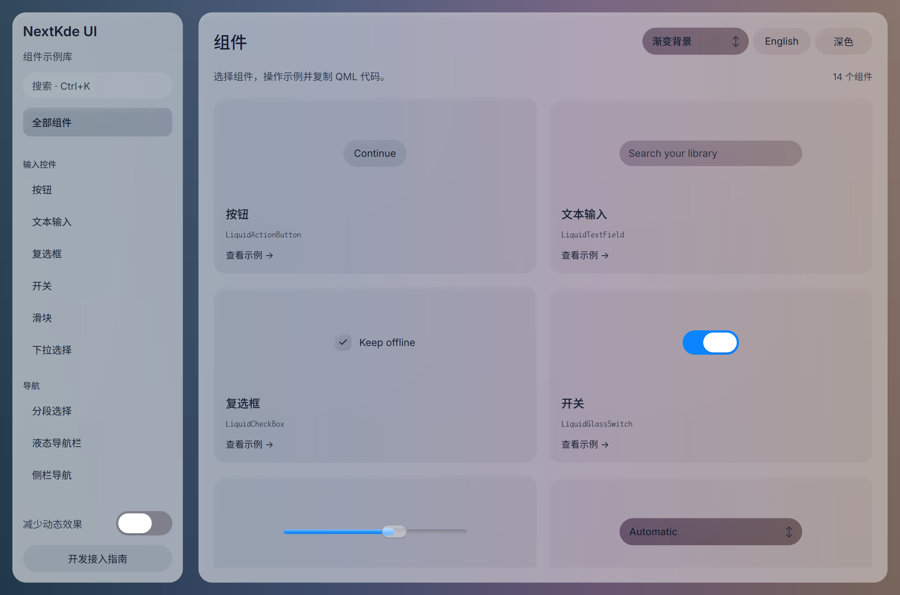

# Gallery progress

Updated: 2026-10-20T23:11:54.135085+08:00

23:10轮新图：App仍运行996c30e，Gallery已热加载共享Switch/Segmented候选4c0f08b；新App正在构建。

截图实际QML热加载候选4c0f08b（包含review IPC c6d2005），静止组件总览页1180x780 DPR2浅色。共享Switch/Segmented去旧整圈高光已提交，动态候选待协调者看连续帧；此静图不等于动画交互验收。NavBar仍pending。源码状态及diff指纹见metadata。

Source: [`4c0f08bd4e05`](https://github.com/NextKde/nextkdeAppDemo/commit/4c0f08bd4e05c77055644cb09d8d7501449f69e0) · Branch: `codex/music-fidelity` · Local changes: False

Captures and builds document progress; UI acceptance is recorded separately.

2360 × 1560 original pixels

[Capture and revision metadata](screenshots/round-20261020-231154/metadata.json)

[All rounds](./screenshots) · [Other project](https://github.com/NextKde/KMusic/blob/ui-evidence/README.md)
