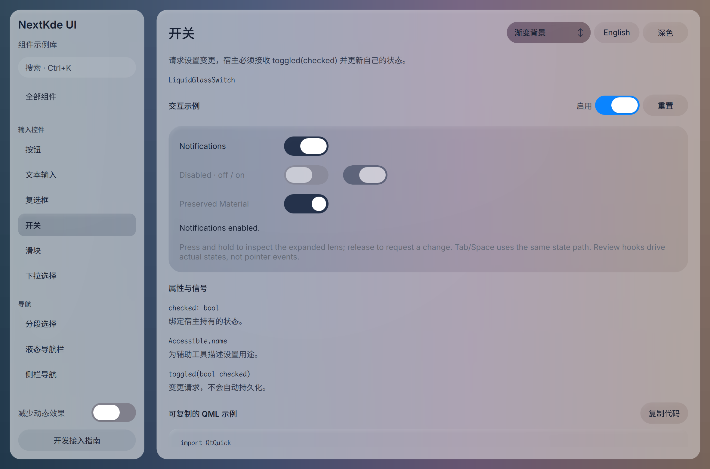
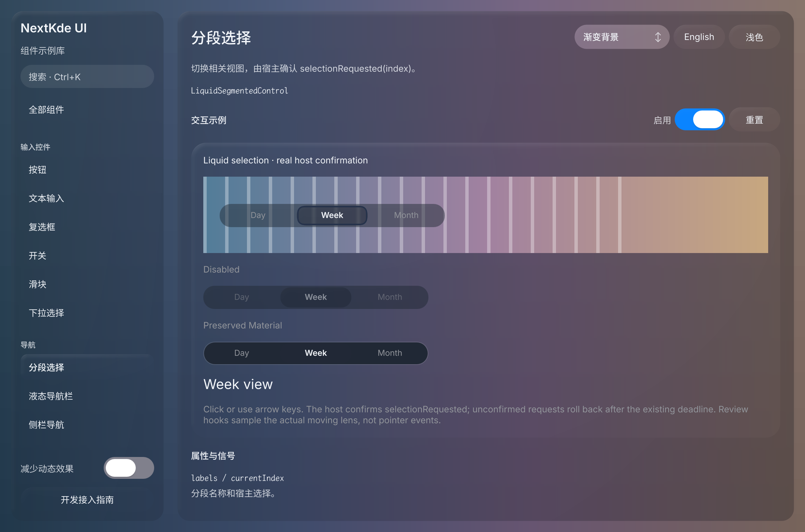

# Gallery progress

Updated: 2026-10-20T23:22:43.754998+08:00

8e167b4布局修复及共享Switch/Segmented材质窄范围复核：新双库截图、1024深色两模式及实际状态驱动动画帧。

实际QML候选4c0f08b，当前新截图为深色Segmented页；补充同候选lightSwitch及darkSegmented含disabled/Material图。已检查宿主拒绝时Switch保持checked、Segmented超时回滚，确认后更新，sampling=true有记录。焦点保留。下一步NavBar独立材质及完整键鼠回归，当前窄范围复核不代表整库或整App验收。

Source: [`4c0f08bd4e05`](https://github.com/NextKde/nextkdeAppDemo/commit/4c0f08bd4e05c77055644cb09d8d7501449f69e0) · Branch: `codex/music-fidelity` · Local changes: False

Captures and builds document progress; UI acceptance is recorded separately.

2360 × 1560 original pixels

2360 × 1560 original pixels

2360 × 1560 original pixels

[Capture and revision metadata](screenshots/round-20261020-232243/metadata.json)

[All rounds](./screenshots) · [Other project](https://github.com/NextKde/KMusic/blob/ui-evidence/README.md)
