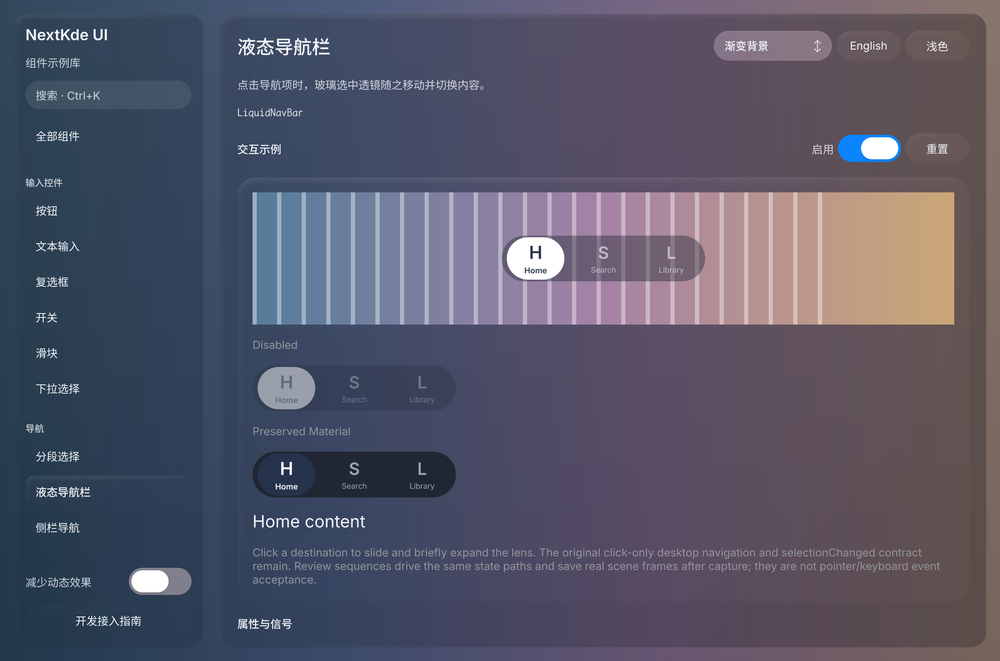
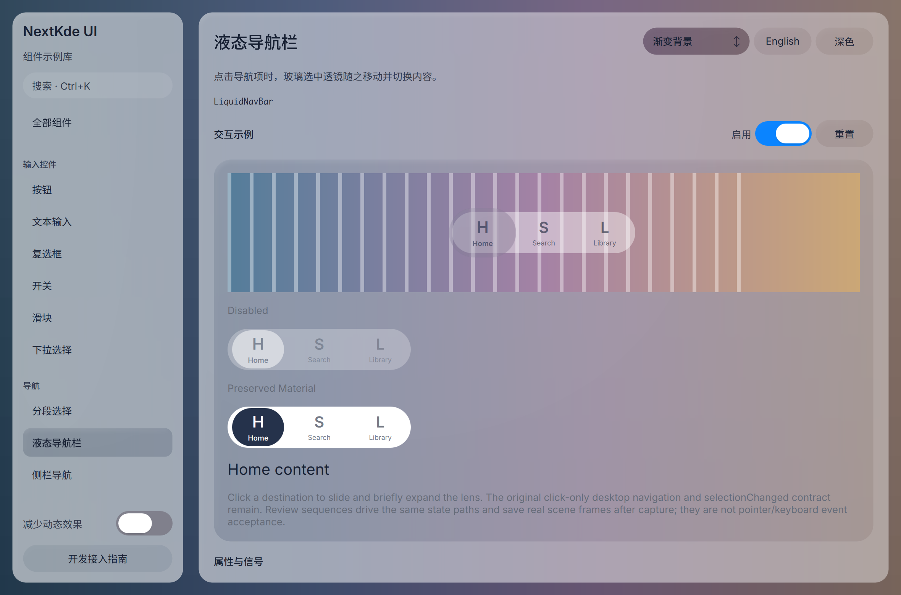

# Gallery progress

Updated: 2026-10-20T23:42:21.033809+08:00

23:38双库新图；导航真实无焦点状态已独立看图并核对focusIndex=-1，上一轮Gallery延迟上传现已确认成功。

当前Nav控件ae9d83e，demo新增真实clearfocus9752b81与review白名单81edb0c。新深色整窗与补充light-expanded-no-focus/dark-rest-no-focus原图已亲自看；focus-off-state实际focusIndex=-1，展开sampling=true。旧高光圈已移除，焦点圈仅focus-on存在；窄材质复核通过，完整键鼠事件链未验收。JSON状态已附。

Source: [`81edb0c9026a`](https://github.com/NextKde/nextkdeAppDemo/commit/81edb0c9026ae8740769f90c7c39b97659312efb) · Branch: `codex/music-fidelity` · Local changes: False

Captures and builds document progress; UI acceptance is recorded separately.

2360 × 1560 original pixels

2360 × 1560 original pixels

2360 × 1560 original pixels

[Capture and revision metadata](screenshots/round-20261020-234221/metadata.json)

[Reviewed state/timing data: data-nav-candidate-focus-off-state.json](screenshots/round-20261020-234221/data-nav-candidate-focus-off-state.json)

[All rounds](./screenshots) · [Other project](https://github.com/NextKde/KMusic/blob/ui-evidence/README.md)
