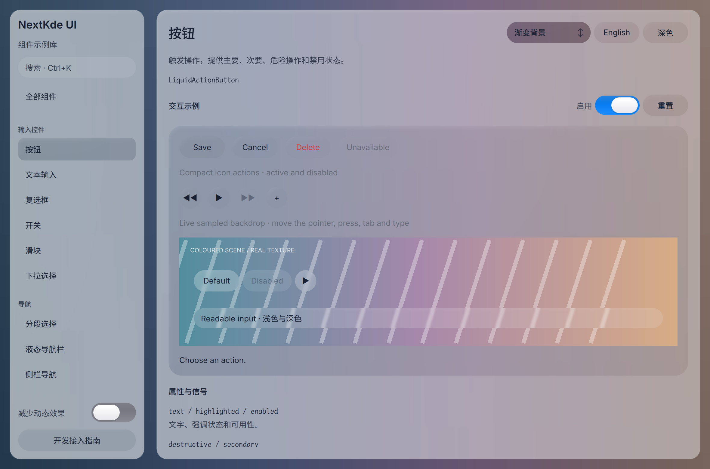

# Gallery progress

Updated: 2026-10-20T22:56:51.454095+08:00

22:53轮新截图；开发者正在修复试听状态恢复，当前截图仍是已运行的选择器材质候选。

实际运行Gallery QML源码68294d2，组件材质72e344c，浅色1180x780 DPR2。完成：方向性柔和反光、输入文字对比、选择器去旧浮雕材质、条纹背景裁切。待做：Switch/Segmented/Nav独立材质审查。当前截图为新捕获按钮页，仅QML场景，Overlay弹出层不在此截图内。

Source: [`68294d21d30d`](https://github.com/NextKde/nextkdeAppDemo/commit/68294d21d30dad4a2ede09f87c4cfcda13637e9c) · Branch: `codex/music-fidelity` · Local changes: False

Captures and builds document progress; UI acceptance is recorded separately.

2360 × 1560 original pixels

[Capture and revision metadata](screenshots/round-20261020-225651/metadata.json)

[All rounds](./screenshots) · [Other project](https://github.com/NextKde/KMusic/blob/ui-evidence/README.md)
