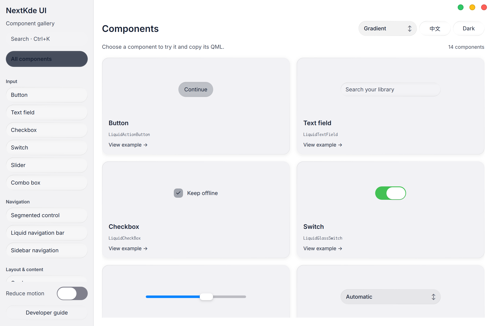

# Gallery progress

Updated: 2026-10-21T21:30:55.475229+08:00

Runtime `96ff101f` · shared `96ff101` · native Qt/QML, local rendering

- Available: QR login UI/session lifecycle, real search/play/pause/next/seek and lyrics; human phone scan and authenticated persistence still require user acceptance.
- Current player fix: local metadata readability plate; optical background kept at panel sides. No second scene capture added.
- In progress: account-expiry and secure-storage deletion failure handling. These source changes are not the captured runtime.
- Design: immersive left playback/right real queue, plain content buttons, fixed liquid overlays. Final visual acceptance belongs to user.

[Exact capture metadata](screenshots/round-20261021-212941/metadata.json)
