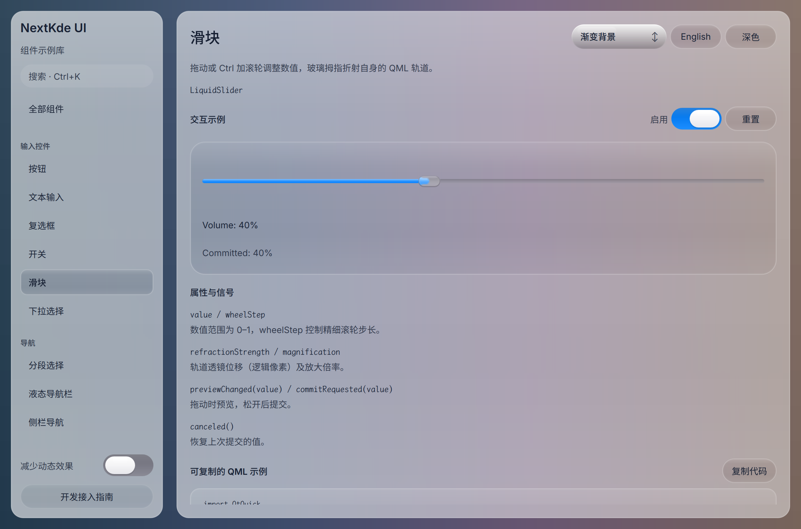
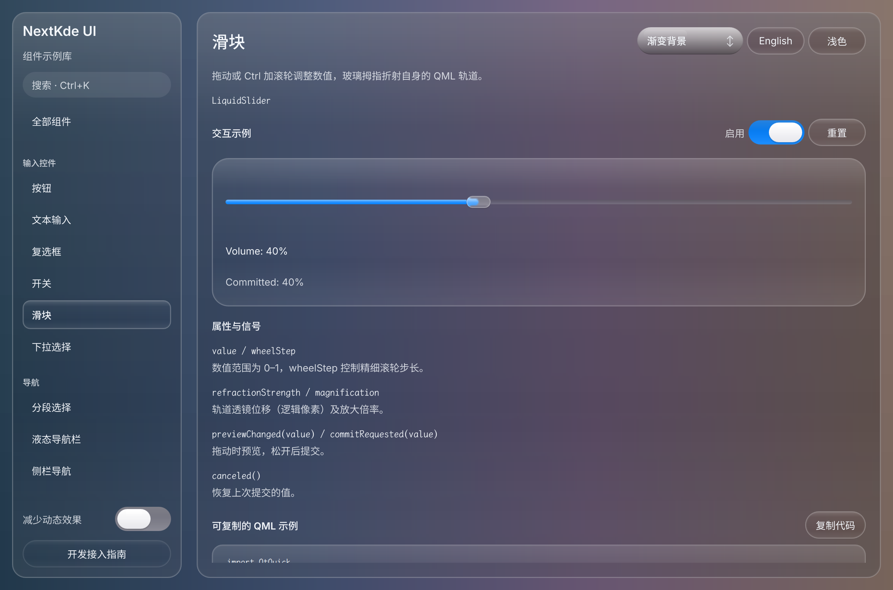

# Gallery progress

Updated: 2026-10-20T22:12:41.862115+08:00

KMusic首版已在本机编译和启动；已完成真实Kos.Ui构建绑定。协调者亲自检查浅深色窗口截图，进入首轮UI修正，SPlayer音源正在接入。

实际Gallery浅深色滑块页已看图；原始像素2360×1560。首次组件回归为紧凑图标按钮和窗控兼容性；Forma逐项还原仍在进行，shader顶点警告保留记录。

Source: [`598046657c7c`](https://github.com/NextKde/nextkdeAppDemo/commit/598046657c7c18f92d0a9514a42ad0a96029af75) · Branch: `codex/music-fidelity` · Local changes: False

Captures and builds document progress; UI acceptance is recorded separately.

2360 × 1560 original pixels

2360 × 1560 original pixels

[Capture and revision metadata](./metadata.json)
