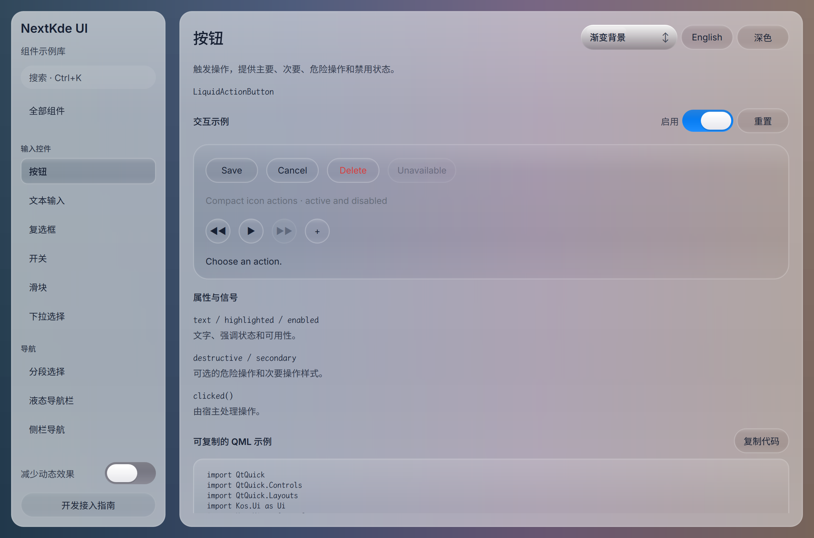

# Gallery progress

Updated: 2026-10-20T22:27:53.274004+08:00

新增用户反馈已进入本轮：侧栏轻微透明/模糊；按钮和input等高光去描边/浮雕。已查Apple官方实图/WWDC并定位共享双圈高光，保留本轮改前基线。

改前共享按钮实图。全周亮边/内圈/固定渐变已定位为本轮待改项，独立Select/Switch/Segmented等也将逐项审查。

Source: [`598046657c7c`](https://github.com/NextKde/nextkdeAppDemo/commit/598046657c7c18f92d0a9514a42ad0a96029af75) · Branch: `codex/music-fidelity` · Local changes: False

Captures and builds document progress; UI acceptance is recorded separately.

2360 × 1560 original pixels

[Capture and revision metadata](./metadata.json)
