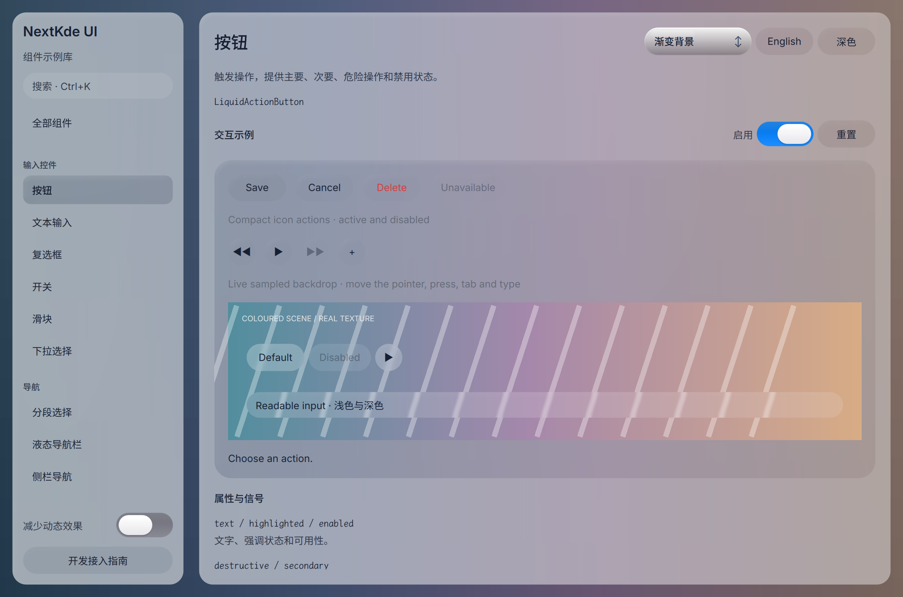

# Gallery progress

Updated: 2026-10-20T22:42:43.615960+08:00

首轮材质修正已本机构建运行并独立看图：共享按钮/input去常驻双圈描边，浅色输入可读；侧栏alpha0.80并向现有合成器提交精确blur区域。

运行新进程，按钮和输入的整圈亮边已去，真实条纹backdrop验证了采样模糊和可读性。静态候选方向通过，完整hover/press/focus/dynamic仍待验收；Gallery保留一条既有vertex input警告。

Source: [`fd51df7302b9`](https://github.com/NextKde/nextkdeAppDemo/commit/fd51df7302b91fca409c5d6b11618304046db6f7) · Branch: `codex/music-fidelity` · Local changes: False

Captures and builds document progress; UI acceptance is recorded separately.

2360 × 1560 original pixels

[Capture and revision metadata](./metadata.json)
