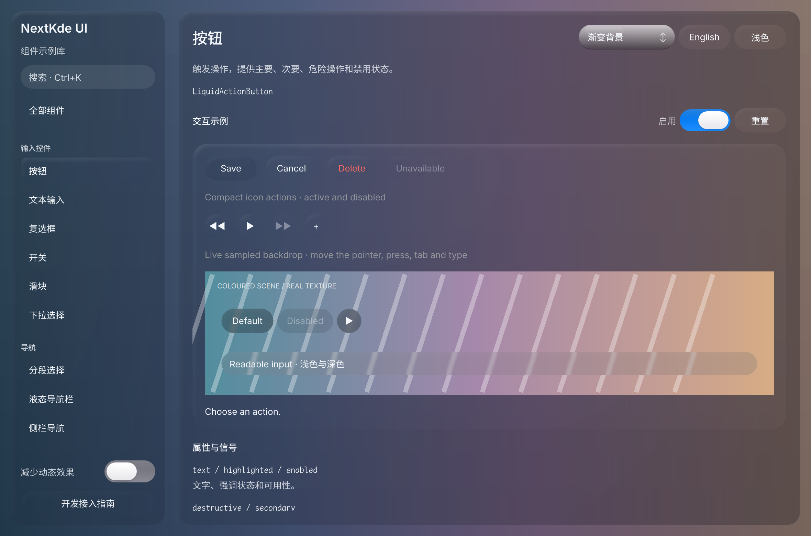

# Gallery progress

Updated: 2026-10-20T22:45:53.845477+08:00

本轮浅深色材质候选已独立看图：button/input双圈描边移除、浅色文字对比修正；侧栏真实alpha及blur请求已核对。独立Select旧bevel进入下一轮。

新进程浅深色按钮和中英输入样例已看图，真实条纹backdrop可见采样柔化。焦点/hover/press完整交互待验收；Select/Switch/Segmented/NavBar独立材质仍待逐项修，条纹场景自身clip已派下一小轮。

Source: [`72e344c5f1b2`](https://github.com/NextKde/nextkdeAppDemo/commit/72e344c5f1b2c7a128bf50b12212e60fe3e37f99) · Branch: `codex/music-fidelity` · Local changes: True

Captures and builds document progress; UI acceptance is recorded separately.

2360 × 1560 original pixels

2360 × 1560 original pixels

[Capture and revision metadata](./metadata.json)
