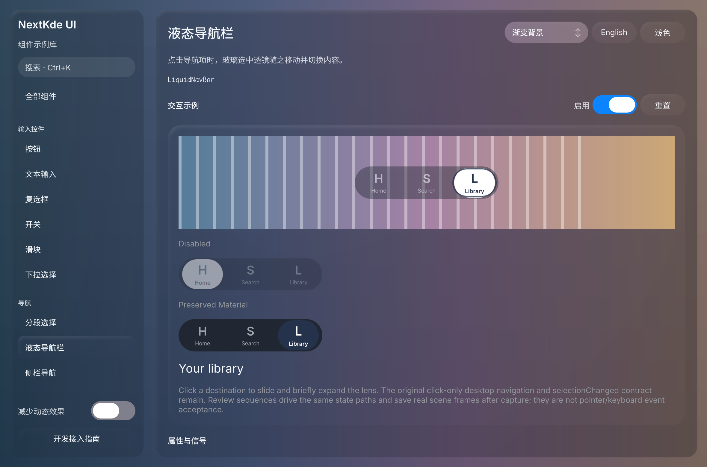
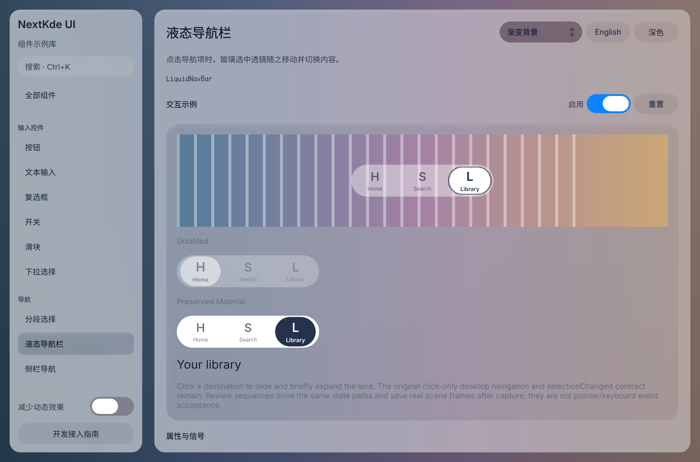
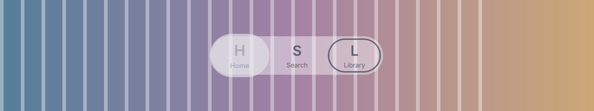
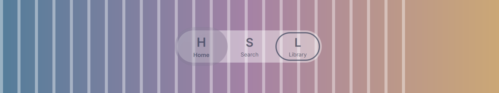
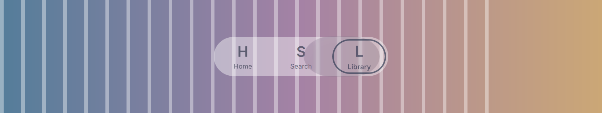

# Gallery progress

Updated: 2026-10-20T23:29:19.513833+08:00

23:28轮导航材质候选ae9d83e：新双库原图及真实示例区域动画帧，窄范围看图复核。

实际热加载NavBar候选ae9d83e与demo IPC0d0928f。新深色整窗+补充浅色整窗及navScene原始区域040/160/300帧，协调者逐图已看。真实状态路径驱动：light实际43/166/311ms，displayX6/6/142.11，旧全周彩白高光已移除；焦点圈独立可见。区域帧收齐后才PNG编码，非整窗截图、非键鼠E2E。focus-off外观和完整键盘还要继续检查。

Source: [`0d0928f5813e`](https://github.com/NextKde/nextkdeAppDemo/commit/0d0928f5813ece42d35daa63d6ce726f0a6a3578) · Branch: `codex/music-fidelity` · Local changes: False

Captures and builds document progress; UI acceptance is recorded separately.

2360 × 1560 original pixels

2360 × 1560 original pixels

1656 × 312 original pixels

1656 × 312 original pixels

1656 × 312 original pixels

[Capture and revision metadata](./metadata.json)
