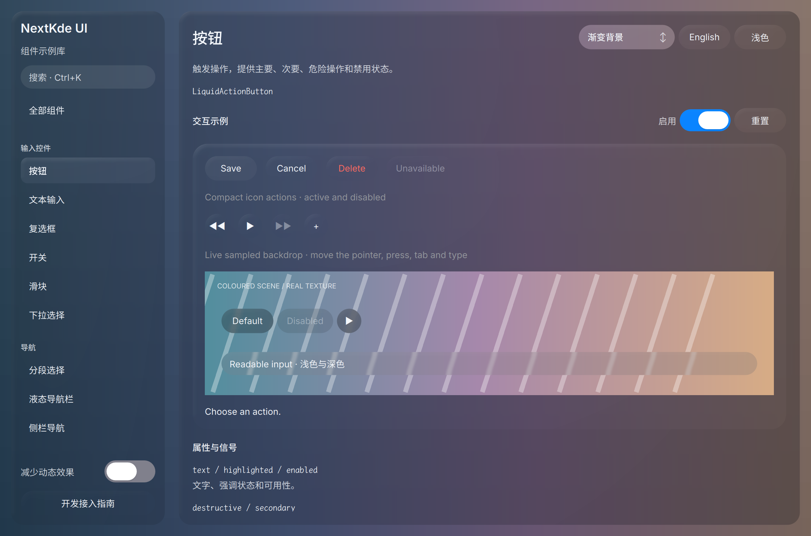

# Gallery progress

Updated: 2026-10-21T08:32:32.320764+08:00

08:29轮Gallery新图成功；当前App截图未生成，未用旧图补位，开发继续。

本轮深色按钮页新原图已亲自看。当前进程启动482后源码热加载039及在途工作；QSB缓存未重启确认，不据HEAD宣称shader二进制运行版本。新共享候选就绪后只重启自有Gallery再回归。

Source: [`9da2794bf70e`](https://github.com/NextKde/nextkdeAppDemo/commit/9da2794bf70e3b598baf1a0fbdc7861d93dfcaa9) · Branch: `codex/music-fidelity` · Local changes: False

Captures and builds document progress; UI acceptance is recorded separately.

2360 × 1560 original pixels

[Capture and revision metadata](./metadata.json)
