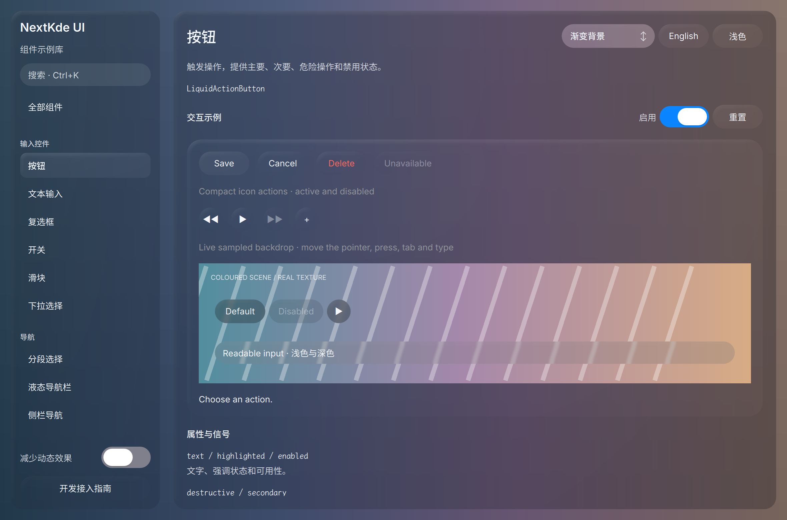

# Gallery progress

Updated: 2026-10-21T08:38:44.510786+08:00

08:34轮：真实匿名新碟内容已进入首页，9da共享液态候选重启Gallery回归；功能与液态连续过程尚在验证。

本轮重启仅自有Gallery，PID38878，启动源码9da2794精确，已实际重新加载QML/QSB；本轮新深色按钮页原图已亲自看，启动日志无旧vertex-input警告。新版Button光学随真实hover/down联动的动态还需连续帧检查，静止图不证明运动。

Source: [`9da2794bf70e`](https://github.com/NextKde/nextkdeAppDemo/commit/9da2794bf70e3b598baf1a0fbdc7861d93dfcaa9) · Branch: `codex/music-fidelity` · Local changes: False

Captures and builds document progress; UI acceptance is recorded separately.

2360 × 1560 original pixels

[Capture and revision metadata](./metadata.json)
