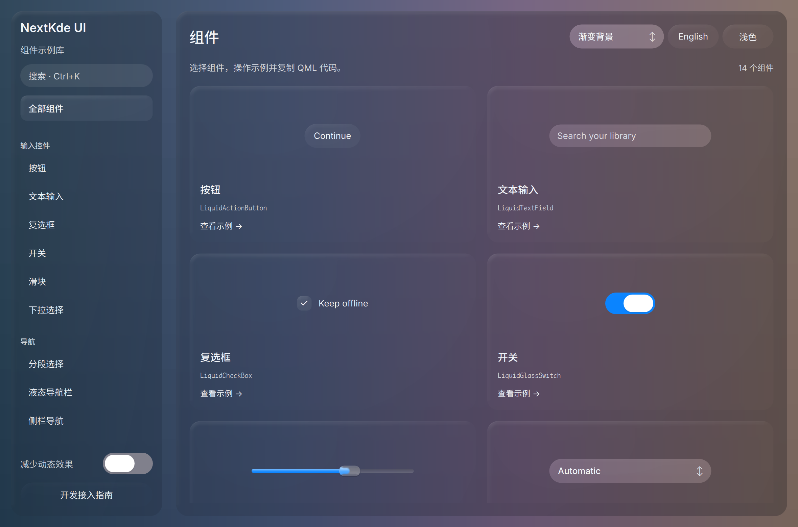

# Gallery progress

Updated: 2026-10-21T08:55:46.220377+08:00

Fresh dual screenshots recovered. Parent inspected current App and restarted owned Gallery; whole UI remains under review.

Restarted ONLY owned Gallery38878 to48688 with same9da source/QSB; fresh dark overview captured and viewed, normal buttons/input/source sampling visible. This is static overview regression, not completed liquid dynamic acceptance. No Shell/KWin config changed.

Source: [`9da2794bf70e`](https://github.com/NextKde/nextkdeAppDemo/commit/9da2794bf70e3b598baf1a0fbdc7861d93dfcaa9) · Branch: `codex/music-fidelity` · Local changes: False

Captures and builds document progress; UI acceptance is recorded separately.

2360 × 1560 original pixels

[Capture and revision metadata](./metadata.json)
